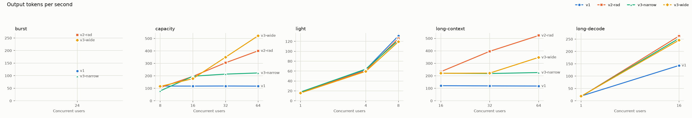
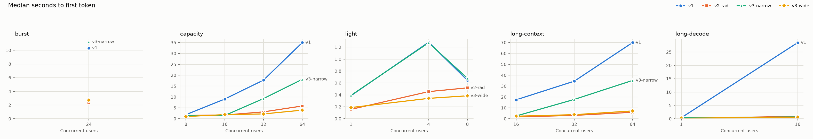
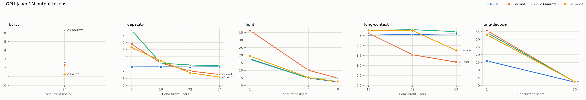

# Serving and model-quality results, 7 Nov 2026

This is the v1/v2/v3 comparison promised in [serving-v3-data-parallel.md](serving-v3-data-parallel.md), plus the first accuracy evaluation of the medical adapter. Full per-cell tables are in [benchmark-tables.md](benchmark-tables.md). Raw request logs are in the ignored `serving/benchmarks/` folder.

## Summary

- **v3-wide is the best general server.** Up to 24 requests in flight it stays on one GPU, at v1's cost. At 32 and 64 users with ordinary prompts it scales to two GPUs and delivers the most tokens per second: 522 tok/s against v2's 401 and v1's 118.
- **v2 is best for long prompts with a crowd.** With about 1,500-token prompts at 32–64 users, v2's pooled KV cache sustained 397–523 tok/s. v3-wide managed 222–348 tok/s and had to preempt (evict and recompute) requests. v2 always bills two GPUs, even for one user.
- **v3-narrow is never the best choice.** It starts a second GPU at only 6 requests in flight and stalls at about 220 tok/s once its 2 × 8 slots fill. It was also the worst stack for a cold burst.
- **v1 is fine for one to a few users.** Past its 8 slots it flattens at about 118 tok/s and the wait for a first token grows linearly: 35 s median at 64 users, 70 s with long prompts.
- **The medical adapter does not improve medical accuracy.** Scored without formatting effects, it ties the base model on MedQA (63.2% vs 63.1%) and MedMCQA (58.1% vs 58.5%), and on PubMedQA (48.3% vs 48.5%). What it does change is format: it answers with the requested letter, where the base model explains first.
- **Spend:** about $3.70 on the Modal bill for all of the work below, including the redone runs, against a $10 cap. The scripts estimated $4.70, because they price every GPU at the dearer A10G rate.







## Setup

| | v1 | v2 (RAD) | v3-narrow | v3-wide |
| --- | --- | --- | --- | --- |
| GPUs | 1 | 2, tensor parallel | up to 2 replicas × 1 | up to 2 replicas × 1 |
| Sequences in flight | 8 | 64 (`max_active`) | 8 per replica | 32 per replica |
| Second GPU starts at | — | always on | 6 in flight | 24 in flight |

- **Tool:** `serving/benchmark.py`. Every request streamed exactly the scenario's output length. Each prompt carried a unique prefix, so prefix caching could not help.
- **Scenarios:** light (short prompts, 1/4/8 users, 2 rounds), capacity (~750-token prompts, 8–64 users), long-context (~1,500-token prompts, 256-token replies, 16–64 users), long-decode (512-token replies, 1 and 16 users), and burst (24 users at once).
- **Run order:** v1, v2 and v3-narrow ran at the same time, as separate Modal apps on separate GPUs. v3-wide ran after a redeploy with `V3_MAX_NUM_SEQS=32`. v3 was then redeployed as narrow, which is how it is left.
- **Warm replicas:** for v3 capacity and long-context, two replicas were held warm with `--warm-replicas 2`, so these numbers are steady state. For burst, one replica was warm and the second had to cold-start.
- **GPUs:**
  - v1 ran on an NVIDIA A10.
  - v3 replicas landed on a mix of A10G and A10.
  - v2's GPU type was not captured. Its runs finished before the logger started; on 6 Nov it ran on A10G.
- **Client:** a Windows desktop calling the `us-east` endpoints over the internet. TTFT therefore includes some tens of milliseconds of network time.
- **Sample size:** each cell is one run, and many cells hold only 8–64 requests. Treat differences under about 10% as noise.

Two runs were redone:
- The first v3-narrow burst started while a second replica was still warm from the previous scenario, so it never measured scale-out. It was rerun after v3 had scaled to zero.
- The first v3-wide attempt overlapped Modal's rolling deploy, which kept routing some requests to the old narrow container. Those results were discarded, and only runs served entirely by the wide version are reported.

## What each stack does under load

**Short prompts, many users (capacity)**

| Users | v1 tok/s | v2 tok/s | v3-narrow tok/s | v3-wide tok/s | v1 TTFT p50 | v2 TTFT p50 | v3-wide TTFT p50 |
| ---: | ---: | ---: | ---: | ---: | ---: | ---: | ---: |
| 8 | 118 | 106 | 80 | 115 | 1.9 s | 1.5 s | 1.0 s |
| 16 | 118 | 196 | 197 | 178 | 9.0 s | 1.7 s | 1.9 s |
| 32 | 119 | 305 | 214 | 350 | 17.7 s | 3.2 s | 2.2 s |
| 64 | 118 | 401 | 223 | 522 | 35.0 s | 5.9 s | 3.9 s |

At 64 users v3-wide also kept per-user speed higher: 0.083 s per token, against v2's 0.116 s. There is no cross-GPU exchange on each token. The gap only shows under load. At one user, v2 decoded at 0.058 s/token, the same as v1, so the 28% single-user penalty measured on 6 Nov did not reproduce.

**Long prompts (long-context)**

| Users | v1 tok/s | v2 tok/s | v3-narrow tok/s | v3-wide tok/s | v3-wide preemptions |
| ---: | ---: | ---: | ---: | ---: | ---: |
| 16 | 121 | 233 | 221 | 220 | 0 |
| 32 | 119 | 397 | 218 | 222 | 3 |
| 64 | 118 | 523 | 226 | 348 | 6 |

This is the case the v3 design predicted v2 would win. Each v3 replica has about 35k tokens of KV cache, against roughly 175k pooled across v2's pair. Wide v3 admits more sequences than fit, so vLLM evicts and recomputes some of them. The cost showed up as a 31 s p99 TTFT at 64 users.

**Burst of 24 users**

| | tok/s | TTFT p50 | TTFT p99 | GPUs |
| --- | ---: | ---: | ---: | ---: |
| v1 | 119 | 10.3 s | 19.0 s | 1 |
| v2 | 262 | 2.4 s | 4.2 s | 2 |
| v3-narrow, second replica cold | 97 | 11.2 s | 23.4 s | 2 (one booting) |
| v3-wide | 241 | 2.7 s | 4.8 s | 1 |

A cold scale-out is the worst case for data parallelism. The second replica took most of the burst to boot, so v3-narrow was slower than v1 while billing for two GPUs. v3-wide never needed a second replica: 24 requests fit within its 32-slot cap.

**Light and long-decode.** At 1–8 users all four stacks delivered 16–19 tok/s per user, and v1 matched everything else. At 16 users with 512-token replies, every multi-GPU stack reached 246–263 tok/s against v1's 143. v1 queued half the users, giving a 28.5 s median TTFT.

**Cost per token.** Per million output tokens:
- **v1:** about $2.60 once full. It is cheapest at 8 users or fewer, because its single GPU is busy.
- **v3-wide:** $1.17 at 64 capacity users.
- **v2:** $1.17 at 64 long-context users.

At one user the two-GPU stacks cost about twice v1, about $33–36 per million tokens.

## The v3 design expectations, checked

| Claim from the v3 design | Result |
| --- | --- |
| DP beats v1 above 8 users | **Confirmed.** Both v3 variants beat v1 from 16 users in capacity, long-context and long-decode. |
| DP beats v2 on per-token speed | **Confirmed under load, refuted alone.** v3-wide had lower TPOT at 32–64 users (0.069–0.083 s vs 0.082–0.116 s). At one user, v2 matched v1. |
| DP is cheaper at light load | **Confirmed for wide, mixed for narrow.** v3-wide stayed on one GPU through 8 users. v3-narrow scaled out at 8 users and billed two GPUs (47% efficiency vs v1). |
| DP improves availability | **Observed, not stress-tested.** Replicas landed on both A10 and A10G. No capacity shortage occurred to test it. |
| DP loses on long prompts at high concurrency | **Confirmed.** v2 led v3-wide by 79% at 32 users and 50% at 64. v3-wide preempted requests. |
| No gain at 1–8 users | **Confirmed.** Throughput was within noise of v1. |
| Sudden bursts hurt DP | **Confirmed for narrow.** 11.2 s median TTFT and 97 tok/s on two GPUs. v3-wide avoided it by not scaling out. |
| Short sessions pay an idle tail per replica | **Not measured directly.** It follows from the 120 s scale-down window; the cost estimates include it. |

## Do the stacks give the same answers?

`serving/parity.py` sent 16 prompts one at a time at temperature 0 to v1 twice, then to v3 and v2.

| Compared with v1's first run | Exact match | Mean shared prefix |
| --- | ---: | ---: |
| v1, second run | 31% | 61% |
| v3 | 62% | 73% |
| v2 | 31% | 59% |

Greedy decoding on vLLM is not bit-for-bit repeatable here: v1 disagreed with itself on 11 of 16 answers. Likely causes are prefix-cache hits on the repeat and the A10/A10G mix. Neither stack differs from v1 more than v1 differs from itself, so there is no evidence that data or tensor parallelism changes what the model says. A stricter test would need vLLM's batch-invariant mode and pinned GPU types.

## Medical accuracy: adapter vs base

`serving/medical_eval.py` asked `qwen-medical` and the unadapted `Qwen/Qwen3-8B` the same questions through the same v1 server, at temperature 0 with thinking disabled.

| Dataset | Questions | What it tests |
| --- | ---: | --- |
| MedQA (USMLE, 4 options) | 1,273, all of the test split | Clinical vignettes |
| MedMCQA | 1,000 sampled from validation | Indian medical-entrance questions, 4 options |
| PubMedQA (`pqa_labeled`) | 1,000 | Yes/no/maybe from an abstract |

The adapter was trained on `nihal-mp/erkamd-human_assistant-llama2-1k`, about 1,000 medical chat examples. None of these benchmarks overlap it.

Accuracy, adapter vs base, with exact McNemar p-values on the paired answers:

| Scoring | MedQA | MedMCQA | PubMedQA |
| --- | --- | --- | --- |
| Strict: an 8-token reply must start with the answer | **63.4% vs 46.0%**, p < 1e-40 | **57.6% vs 51.2%**, p < 1e-5 | 48.3% vs 48.5%, p = 0.92 |
| Lenient: unanswered questions re-asked with 384 tokens | 63.6% vs 62.5%, p = 0.31 | 57.8% vs 58.8%, p = 0.47 | same as strict |
| **Log-probability: the likeliest letter after "The answer is ("** | **63.2% vs 63.1%, p = 1.0** | **58.1% vs 58.5%, p = 0.73** | — |

95% Wilson intervals are about ±2.7 points on MedQA and ±3 on the others.

The strict score made the adapter look about 17 points better. That gap was entirely formatting. The base model began 560 of 3,273 replies with an explanation, such as "The clinical presentation is consistent with…", and ran out of tokens before naming a letter. The adapter did that 15 times.

Log-probability scoring reads the model's choice directly. It ends the prompt with "The answer is (", and in both models at least 97.5% of the next-token probability fell on A–D. Under that scoring the two are indistinguishable.

On PubMedQA, both models answered "maybe" about half the time. Only about 11% of the labels are "maybe", which holds both near 48%.

Conclusion: the rank-64 LoRA taught a concise, direct answer style. It did not add measurable medical knowledge, which is unsurprising from 1,000 chat examples. To get a knowledge gain, train on exam-style or guideline data and evaluate with log-probability scoring from the start. These benchmarks measure multiple-choice recall. They do not measure safety, bedside manner, or the quality of free-text advice.

## Reproduce

```sh
python -m serving.benchmark --api-version v1 --scenario capacity --budget-usd 1
python -m serving.benchmark --api-version v2 --scenario capacity --config policy=rad,max_active=64,chunk=256
python -m serving.benchmark --api-version v3 --label v3-narrow --scenario capacity --warm-replicas 2
V3_MAX_NUM_SEQS=32 modal deploy --strategy recreate --env main serving/modal_app_v3.py
python -m serving.benchmark --api-version v3 --label v3-wide --scenario capacity --warm-replicas 2 --replica-inputs 32
python -m serving.parity --apis v1,v3,v2
python -m serving.medical_eval --api-version v1
python -m serving.medical_eval --scoring logprob --datasets medqa,medmcqa
python -m serving.report "serving/benchmarks/20261107-*/summary.json" --out docs/benchmark-tables.md --charts docs/img
```

Use `--strategy recreate` when switching v3 between narrow and wide. The default rolling deploy keeps old containers serving until the new ones are up, which mixes the two configurations within a run. For burst, wait until the app shows zero containers, so the second replica really starts cold. On Windows, set `PYTHONUTF8=1`, or Modal's CLI fails to print its check marks.
