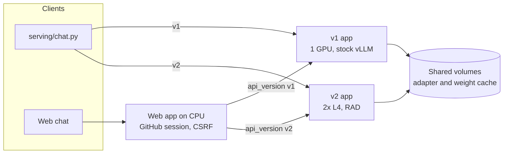
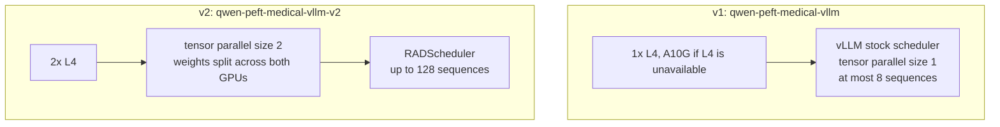
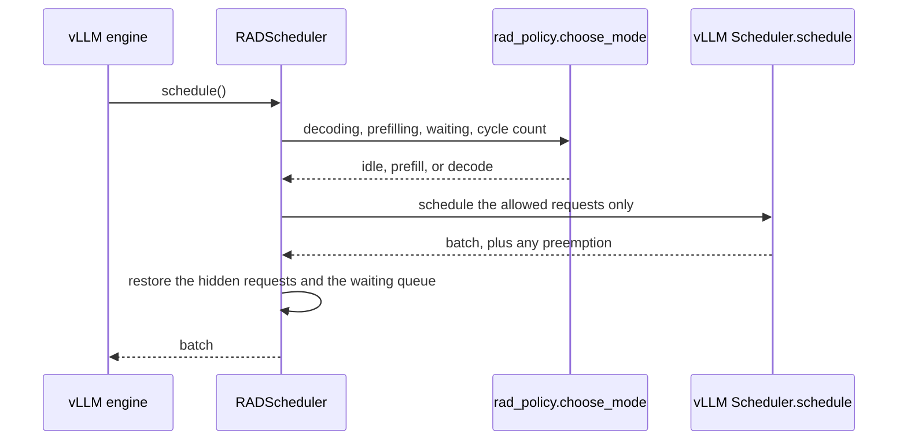
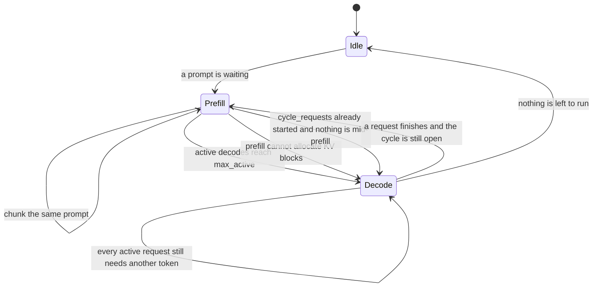
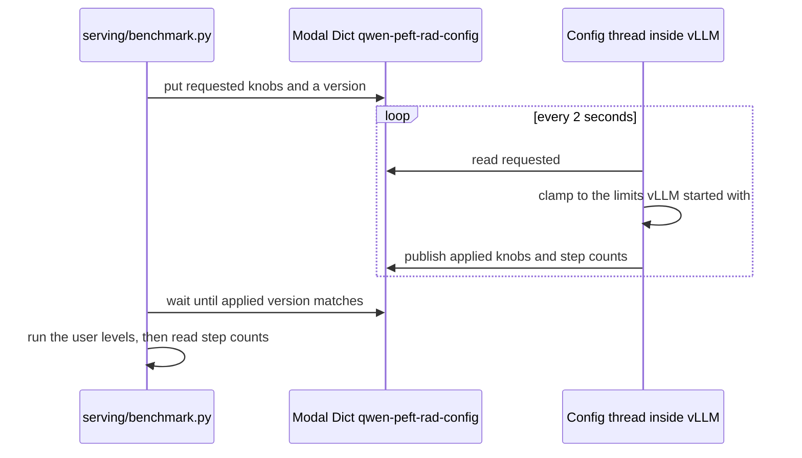

# Serving API v2

A third stack, v3, replicates the single-GPU server instead of splitting it. See [serving-v3-data-parallel.md](serving-v3-data-parallel.md).

This change adds a second inference stack next to the existing one. v1 stays a single GPU with vLLM's stock scheduler. v2 runs the same Qwen3-8B medical adapter on two L4 GPUs with tensor parallelism, and schedules batches with the Resource-Aware Dynamic (RAD) policy from [Bari, Hegde, and de Veciana, arXiv:2508.01002](https://arxiv.org/abs/2508.01002).

"API version" names which Modal app serves the request. Both apps speak the OpenAI path `/v1/chat/completions`. The version is chosen by the client (`--api-version`) or the web page selector, not by a different URL path.

## Concepts

A request has two phases.

- **Prefill** reads the whole prompt and writes the key/value (KV) cache. It is compute-heavy and can use the GPU's matrix units well.
- **Decode** generates one token at a time. Each step is small, so the GPU stays busy only when many decodes run together.

**KV cache** is the stored attention state. It grows with every token and is the usual memory limit on how many requests can run at once.

**Time to first token (TTFT)** is the wait before the first streamed token. **Time between tokens (TBT)** is the gap between later tokens. RAD targets throughput. It does not enforce per-user TBT deadlines. The paper's other scheduler, SLAI, does that, and is not implemented here.

**Tensor parallelism** splits each layer's weight matrices across GPUs. Every GPU runs every layer on its shard, then the GPUs exchange partial results. The model weights occupy less memory on each GPU, which leaves more room for KV cache.

**Continuous batching** puts tokens from many requests into one GPU step. vLLM already does this. RAD decides which requests are allowed into that step.

## How a request moves



The browser never sees Modal credentials. The web app attaches them when it proxies the stream. Tokens are forwarded as newline-delimited JSON (`{"type":"token"}`) and painted into the assistant message as they arrive. The page disables the version selector while a reply is in progress, and the status line names the version that served it.

v1 reads `MODEL_ENDPOINT`. v2 reads `MODEL_ENDPOINT_V2`. A version with no HTTPS URL is rejected by the CLI and disabled in the page.

## The two deployments



| | v1 | v2 |
| --- | --- | --- |
| File | `serving/modal_app.py` | `serving/modal_app_v2.py` |
| GPUs | 1× L4, A10G fallback | 2× L4 only |
| List price while running | about $0.80/hour | about $1.60/hour |
| Idle before scale-to-zero | 5 minutes | 2 minutes |
| Scheduler | vLLM default | `rad_scheduler.RADScheduler` |
| Concurrent sequences | 8 | up to 128, then clamped by the live knobs |

Both apps load `Qwen/Qwen3-8B` in BF16, check that `/adapters/medical` is the rank-64 LoRA trained on that base, and register it as `qwen-medical`. They share `qwen-peft-adapters`, `qwen-peft-hf-cache`, and `qwen-peft-vllm-cache`, so v2 does not re-download the base weights.

v2 scales down sooner because an idle container bills two GPUs. It does not fall back to A10G: a mixed pair cannot do tensor parallelism, and two A10Gs would cost more than the budget this stack was sized for.

### Why two L4s

An 8B model in BF16 already fits on one 24 GB GPU. Splitting it is not required to load the weights. The reason to split is KV cache. With the weights halved on each GPU, more memory is free for in-flight requests, so more users can decode at once.

The cost is communication. L4s on Modal are linked over PCIe, not NVLink. Every layer waits on that link. A single quiet request can be slower on v2 than on v1. v2 is meant to win when many requests are in flight. The benchmark exists to measure that, rather than to assume it.

`--enforce-eager` is on for both apps. CUDA graphs would save latency but reserve extra memory and add compile time on a stack that scales to zero.

## RAD inside vLLM

vLLM's V1 scheduler already allocates KV blocks, preempts requests when memory runs out, and applies LoRA. Replacing that would risk getting memory accounting wrong. RAD subclasses it and, each step, hides the requests that the current mode should not run. vLLM then schedules only the visible set.



`rad_policy.py` has no vLLM imports, so the mode choice is unit-tested locally. `rad_scheduler.py` is imported by the engine-core process from `/opt/rad`, which the image adds through a `.pth` file. The image also installs the Modal client, because that process is not the Modal function process and needs its own client to read the config dict.

### The two modes

The paper's RAD keeps a cycle of at most `N` newly admitted requests (`cycle_requests`) and a target decode batch of `b_col` (`max_active`). Prefill chunks are `LCM(b_row, b_col, b_red)` tokens (`chunk`). On this hardware those tile sizes are a stand-in: vLLM picks the real matrix tiles, and `chunk` is the token budget we hand it.



- **Prefill.** One request, `chunk` tokens. A prompt longer than `chunk` continues on later prefill steps before another prompt starts.
- **Decode.** One new token for every request that has finished prefill, batched together. New prompts wait.
- **Blocked prefill.** If a prefill step schedules nothing while decodes are active, the next step is forced to decode so KV blocks can be freed.
- **Cycle drain.** Once `cycle_requests` have been admitted and no prefill is mid-flight, RAD finishes the active decodes before admitting more. This is the paper's bound that keeps a cycle from growing without limit.

`policy=vllm` skips the mode switch and runs vLLM's prefill-first scheduler under the same `max_active` and `chunk` caps. That is the baseline for batching experiments on the same two GPUs.

### Changing batch size without a redeploy



Startup limits are `--max-num-seqs 128` and `--max-num-batched-tokens 2048`. A requested `max_active` or `chunk` above those is clamped. Invalid values are rejected and the previous knobs stay. If the dict cannot be read, the server keeps the environment defaults (`policy=rad`, `max_active=64`, `chunk=256`, `cycle_requests=256`) and logs the failure.

One cold start can therefore compare stock vLLM against RAD, and compare chunk sizes, without deploying again.

## Load test and the spending cap

`serving/benchmark.py` pretends several users are typing at once. Each user sends a fixed number of streaming requests back to back. Prompts are medical questions with a unique prefix so prefix caching does not skip prefill. By default each request generates exactly 128 tokens, so runs can be compared.

The script estimates GPU cost as it goes:

```text
(elapsed seconds + idle scale-down tail) x GPUs x $0.80 / 3600
```

The tail is 300 seconds for v1 and 120 seconds for v2, because that is how long the container keeps billing after the last request. When the estimate reaches `--budget-usd` (default $2), it stops starting requests. Requests already running are allowed to finish. The estimate uses the L4 list price and leaves out CPU and memory, which add a few percent. The Modal dashboard is the actual bill.

Results go to the ignored directory `serving/benchmarks/<timestamp>-<api>/` as `requests.jsonl` and `summary.json`: TTFT, TBT, end-to-end latency, output tokens per second, and, on v2, how many steps were prefill versus decode.

## Decision log

| Decision | Choice | Why |
| --- | --- | --- |
| Version boundary | A second Modal app and URL | v1 stays deployable on its own. A bad v2 scheduler cannot take down the single-GPU endpoint. |
| Version signal | `MODEL_ENDPOINT` vs `MODEL_ENDPOINT_V2`, plus `api_version` on the web request | The OpenAI path stays `/v1/chat/completions`, which is what vLLM serves. |
| GPUs | 2× L4 | Cheapest pair that holds this model with room for KV cache. Two T4s are 16 GB and tight. Two A10Gs cost more. |
| Parallelism | Tensor parallel size 2 | Matches "one model, two GPUs." Pipeline parallelism would need different stage code and would not split KV the same way. |
| Scheduler integration | Subclass vLLM's V1 scheduler and hide requests | Keeps KV allocation, preemption, and LoRA in vLLM. Custom schedulers are not a public vLLM API, so the image tag stays `v0.11.0`. |
| Policy code | `rad_policy.py` separate from vLLM | The mode rules can be tested on a laptop. |
| Live knobs | Modal Dict, polled every 2 seconds | A batch-size sweep should not pay for a new cold start per point. |
| SLAI | Not built | The request was RAD plus batching experiments. SLAI needs per-request TBT classes the API does not have. |
| Streaming | Kept the existing NDJSON token stream | The page already appends each token. v2 uses that same proxy. |
| Benchmark cost | Stop launching at a dollar cap, default $2 | Includes cold start and the idle tail, so a sweep cannot run on after the script exits. |
| PR review bot | GitHub Actions running pytest, not Cursor Bugbot | Bugbot comments as an external bot, but each review spends Cursor usage (about $1–$1.50) and can bill on-demand. The check below does not. |

## Pull request checks

Cursor hooks run inside the editor. They do not run when GitHub opens a pull request, and a hook that launched a review agent would spend the same Cursor usage as chatting with one.

Cursor Bugbot does run on pull requests, as Cursor's GitHub app rather than as your user. It is usage-priced: reviews consume included Cursor usage first, then on-demand spend if that is enabled. Average cost published by Cursor is about $1.00–$1.50 per review. It is not enabled for this repo.

`.github/workflows/pr-checks.yml` runs on every opened, updated, or reopened pull request. The check is published by `github-actions[bot]`, not by your GitHub user. It installs the web, bench, and test extras and runs `pytest`. It does not call Cursor, Modal, or a model API, and it does not start a GPU. GitHub-hosted `ubuntu-latest` minutes are included for public repositories; private repositories draw on the account's included Actions minutes.
