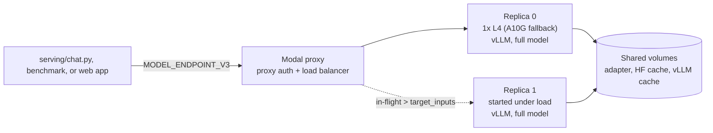
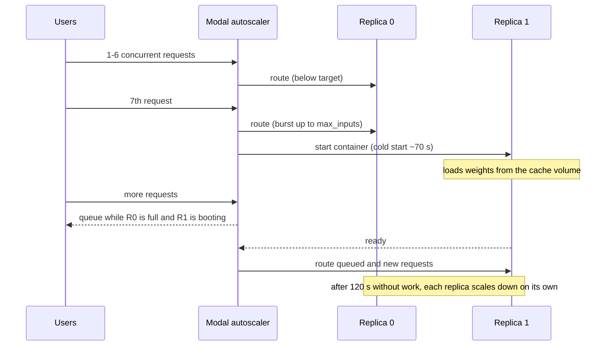

# Serving API v3: data-parallel replicas

v3 serves the same Qwen3-8B medical adapter as v1 and v2, through the same OpenAI path `/v1/chat/completions`. It uses a third way to put the model on more than one GPU. Each GPU holds a **full copy** of the model, and incoming requests are spread across the copies.

Results from the benchmark campaign are in [serving-benchmark-results.md](serving-benchmark-results.md). The v2 design and the RAD scheduler are in [serving-v2-architecture.md](serving-v2-architecture.md).

## Three ways to use more GPU

| | v1 | v2 | v3 |
| --- | --- | --- | --- |
| File | `serving/modal_app.py` | `serving/modal_app_v2.py` | `serving/modal_app_v3.py` |
| Idea | One GPU, one model | One model split across two GPUs (tensor parallel) | Two independent models, one per GPU (data parallel) |
| GPUs while busy | 1 | 2 | 1 or 2, decided by load |
| GPUs while lightly used | 1 | 2 | 1 |
| Cross-GPU traffic per token | None | An all-reduce per layer over PCIe | None |
| KV cache room | About 35k tokens | About 175k tokens, pooled | About 35k tokens per replica, not pooled |
| Sequences in flight | 8 | Up to 64 (RAD cap) | `V3_MAX_NUM_SEQS` per replica: 8 ("narrow") or 32 ("wide") |
| Scheduler | vLLM default | RAD | vLLM default on each replica |
| Mixed GPU types allowed | n/a | No; a pair must match | Yes; each replica falls back on its own |
| Idle before scale-down | 5 minutes | 2 minutes | 2 minutes per replica |

**Data parallelism** runs N copies of the whole model. Copies never talk to each other. A request is served from start to finish by one copy. Throughput can grow up to N times. Each request runs at single-GPU speed, so nothing is added per token.

**Tensor parallelism** (v2) cuts every weight matrix in half and puts one half on each GPU. Each GPU then holds half the weights, so the freed memory goes to KV cache, and that cache is shared by one scheduler. The cost is a synchronisation between GPUs in every layer of every step.

**Continuous batching** happens inside each vLLM process in all three stacks. Data parallelism multiplies the number of batches. Tensor parallelism makes one batch larger.

## How a request moves



The routing is done by Modal, not by vLLM. Each replica is an ordinary v1-style container. The function is declared with:

- `@modal.concurrent(max_inputs=V3_MAX_NUM_SEQS, target_inputs=0.75 × max_inputs)`. When a replica's in-flight count passes the target, the autoscaler starts another replica. The running replica can absorb a burst up to `max_inputs` in the meantime. `max_inputs` equals vLLM's `--max-num-seqs`, so a request that reaches a replica is admitted at once. Requests beyond the total capacity wait in Modal's queue, not inside vLLM.
- `max_containers=2`. The bill can never exceed two GPUs, the same ceiling as v2.
- `min_containers=0`, `scaledown_window=120`. With no traffic there is nothing to pay for. A single user wakes one replica, which costs the same as v1.

## Scaling out under load



The first replica's cold start is the same as v1's. The second replica's cold start falls on users who are already waiting. That is the main operational cost of scaling to zero, and the `burst` benchmark scenario measures it.

## Choosing the per-replica cap

`V3_MAX_NUM_SEQS` is read when you deploy and baked into the image environment, so the container and the decorator agree:

```sh
modal deploy --env main serving/modal_app_v3.py                     # narrow: 8 per replica, 16 total
V3_MAX_NUM_SEQS=32 modal deploy --env main serving/modal_app_v3.py  # wide: 32 per replica, 64 total
```

- **Narrow** is exactly two v1 servers. It isolates what data parallelism adds to v1.
- **Wide** gives v3 the same total admission as v2's RAD cap of 64. It compares the two parallelism strategies at equal concurrency.

A higher cap only helps while the KV cache can hold every admitted sequence. Rough arithmetic for Qwen3-8B in BF16 on a 24 GB GPU at `--gpu-memory-utilization 0.90`:

| | Per token | Usable for KV | Tokens of KV |
| --- | --- | --- | --- |
| KV cost of one token | 36 layers × 8 KV heads × 128 dims × K and V × 2 bytes ≈ **147 KB** | | |
| One v1/v3 replica | | about 21.6 GB − 16.4 GB of weights ≈ 5 GB | **about 35k** |
| v2 pair (each GPU holds half the weights) | | about 2 × (21.6 − 8.2) ≈ 26 GB | **about 175k** |

With 750-token prompts and 128-token replies, about 40 sequences fit on one replica, so wide v3 should hold 32 per replica comfortably. With 1,700-token sequences, only about 20 fit. Past that, vLLM preempts and recomputes requests, and v2's larger pooled cache should win. These numbers are estimates. The `long-context` scenario measures the real behaviour, and `preemptions` in the results counts how often vLLM had to evict.

## Expected wins and losses

The benchmark tests each of these claims on both sides. The results doc marks each one confirmed or refuted.

DP should win:

- **Against v1 above 8 users.** Two GPUs run two full batches.
- **Against v2 on per-token speed.** There is no all-reduce. v2 decoded at 0.069 s/token alone against v1's 0.054 s.
- **On cost at light load.** Only one GPU is billed until traffic needs the second.
- **On availability.** Each replica can land on a different GPU type.

DP should lose, or not be worth it:

- **Long prompts at high concurrency.** The KV cache is split rather than pooled.
- **1-8 users.** There is no gain over v1. Holding a second replica warm only doubles the bill.
- **Sudden bursts from zero.** The second replica's cold start lands in user-visible TTFT.
- **Short sessions.** Each replica that wakes bills a 120 s idle tail.

## Benchmark tooling

`serving/benchmark.py` drives all three stacks with the same simulated users. Additions for v3:

- **Replica-aware cost.** For v3, the script polls `Function.get_current_stats()` every 2 s and integrates the number of live containers into GPU-seconds. Between samples it uses the larger of the two counts. If a poll fails, or before the first sample, it charges for every replica. The idle tail is charged per container still running. The budget guard stops new requests on this estimate. Prices are the workspace list prices (`modal billing rates`): L4 $0.80/h and A10G $1.10/h. The estimate always uses the dearer GPU a stack may fall back to.
- **`--warm-replicas N`** calls `update_autoscaler(min_containers=N)` before the run and resets it to 0 in a `finally`, so no replica is left pinned on. Before measuring, it waits until N distinct replicas answer. Overflow waves force traffic onto the second replica, and `/metrics` probes identify each replica by its `process_start_time_seconds`.
- **Scenarios:**
  - `light`: 1/4/8 users, short prompts.
  - `capacity`: 8/16/32/64 users, about 750-token prompts.
  - `long-context`: 16/32/64 users, about 1,500-token prompts, 256-token replies.
  - `long-decode`: 1/16 users, 512-token replies.
  - `burst`: 24 users at once against one warm replica.
- **TPOT.** Time per output token is `(e2e − TTFT) / (tokens − 1)` for each request. It replaces single inter-token gaps as the per-user speed metric, because the proxy sometimes delivers several tokens in one network read. Gap percentiles are still recorded. On Nov 6 they showed v2 with a p50 gap of 0 s and a p99 of 0.19 s, while its real decode time was 0.069 s/token.
- **Preemptions.** After each level, the script reads `vllm:num_preemptions_total` from each replica's `/metrics` endpoint.

`serving/report.py` reads the `summary.json` files and writes the comparison tables and charts:

- throughput;
- TTFT;
- TPOT;
- GPUs billed;
- efficiency per GPU against v1;
- $ per 1M output tokens;
- preemptions;
- crossover points.

`serving/parity.py` asks v1 twice, then v3 and v2, the same 16 prompts one at a time at temperature 0, and compares the answers text for text.

## Decision log

| Decision | Choice | Why |
| --- | --- | --- |
| Where to load-balance | Modal's autoscaler, one GPU per container | The second GPU is billed only under load. vLLM's `--data-parallel-size 2` keeps both GPUs in one container, so it bills two GPUs whenever it is up and both must match. |
| Replica count | `max_containers=2` | Same spending ceiling as v2, so the comparison is GPU for GPU. |
| Scale-out trigger | `target_inputs` = 75% of `max_inputs` | Starts the second replica before the first is full. The headroom absorbs arrivals during the ~70 s cold start. |
| Per-replica cap | Deploy-time `V3_MAX_NUM_SEQS`, 8 or 32 | 8 isolates "two v1s". 32 matches v2's 64 in total. A runtime knob like v2's Modal Dict would need a custom scheduler; a redeploy is free. |
| Scheduler | vLLM default | One change at a time: v3 differs from v1 only in replication. RAD's gain on v2 came from admitting more requests, which the wide cap also does. |
| GPU fallback | L4, else A10G, per replica | Replicas share nothing, so a mixed pair is fine. v2 cannot do this. |
| Scale-down | 120 s | Each replica's idle tail costs one GPU. v1 keeps 300 s because it is the interactive endpoint. |
| Code layout | A third app file that mirrors v1 | Keeps the one-file-per-stack pattern. Each stack deploys and stops on its own. |
| Per-user speed metric | TPOT rather than single-gap TBT | Gaps are distorted when the proxy delivers several tokens at once. |
| Quality check | Greedy parity against v1, with v1 repeated for a noise floor | The weights are identical, so the answers should be too. A medical accuracy benchmark is out of scope. |

## Deploy and stop

```sh
modal deploy --env main serving/modal_app_v3.py
```

Save the printed URL as `MODEL_ENDPOINT_V3` in `.env`. The web app shows the v3 option once `MODEL_ENDPOINT_V3` is in the `qwen-medical-web-config` secret.

```sh
python -m serving.chat --api-version v3 "What is an antibody?"
python -m serving.smoke_test --api-version v3
modal app stop qwen-peft-medical-vllm-v3 --env main
```
